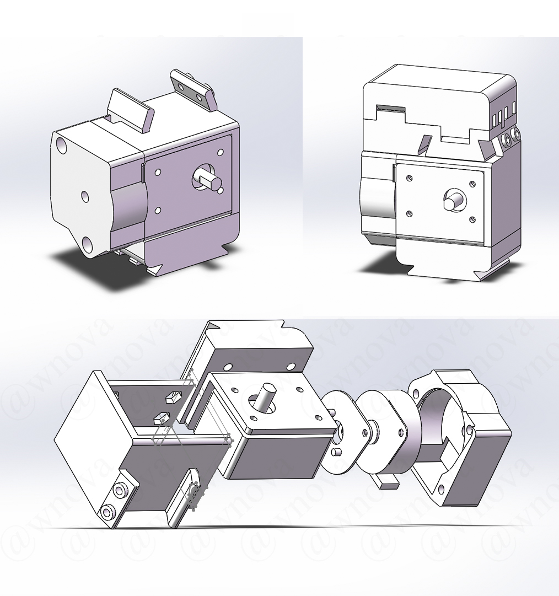
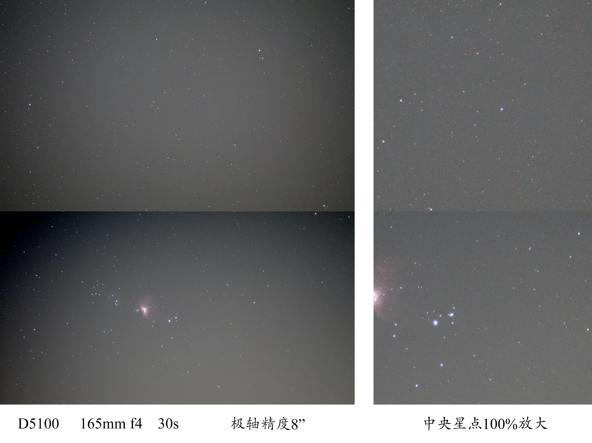
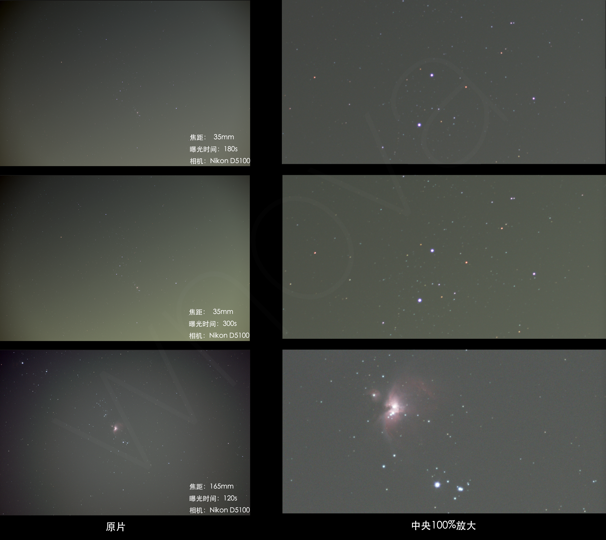

# Nano Light
    
#### 介绍
DIY Lightweight Startracker / Adventurer Equatorial Mount    
一款低成本、易DIY的轻量级星野赤道仪/追踪器

特点：    
*支持约200mm焦距(全画幅)   
*成本仅150元    
*无电路焊接    
*支持南北半球、多种自定义速度     
*可集成激光头，用于对极轴/辅助寻星   
 **注意** /// **激光严禁照射人眼/镜头/飞机等，也不可在他人拍照时使用 违反上述使用规则，后果自负** ///    

感谢黑灯(bilibili ID :黑灯kuro)的原始设计    
见[DIY手机星野赤道仪](https://bbs.imufu.cn/forum.php?mod=viewthread&tid=779955&highlight=手机星野赤道仪)    
建模过程得到扇子学长的帮助，感谢他们的贡献    

#### 测试

#### 软件架构
基于Arduino，需安装MsTimer2库

#### 安装教程

1.  下载Arduino IDE
2.  安装MsTimer2库
3.  连接Arduino Nano并上传代码

#### 使用说明

1.  模型文件见3D model    
    *由于内置激光头很容易发热，并且比指星笔更贵，推荐大家用指星笔    
    *1:3000减速箱理论精度高一些，1:1000减速箱最快速比1:3000减速箱快3倍 可根据自己的需要购买减速箱
2.  1:3000减速箱代码见 Code -> tracker_3000    
    1:1000减速箱代码见 Code -> tracker_1000    
    

#### 视频教程
[点击这里](https://www.bilibili.com/video/BV1gi4y1R7HK?share_source=copy_web)

#### 重要更新
请2022/01/02日13:00前下载代码的制作者进行程序更新，修复了跟踪过快的问题

